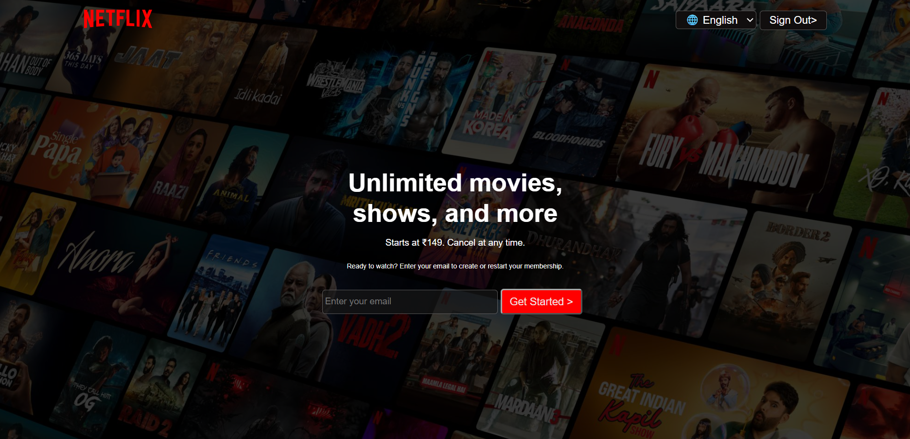
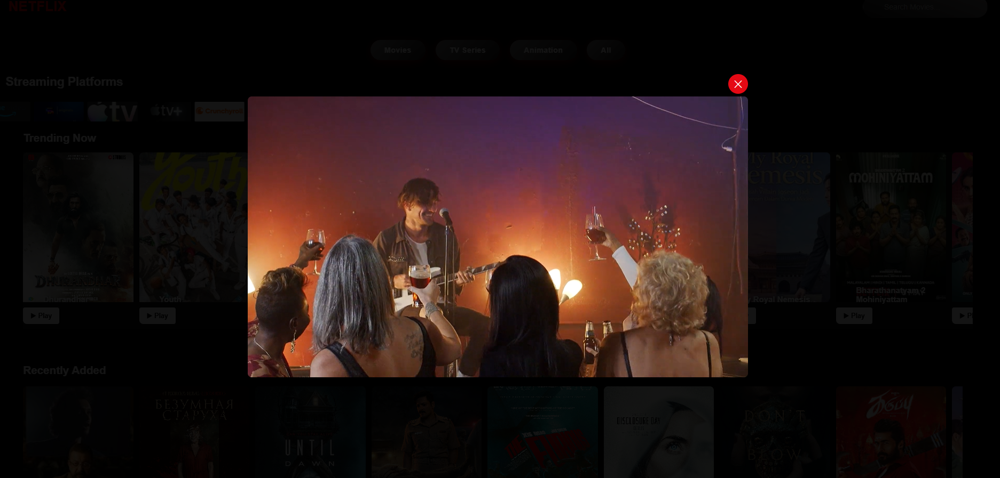
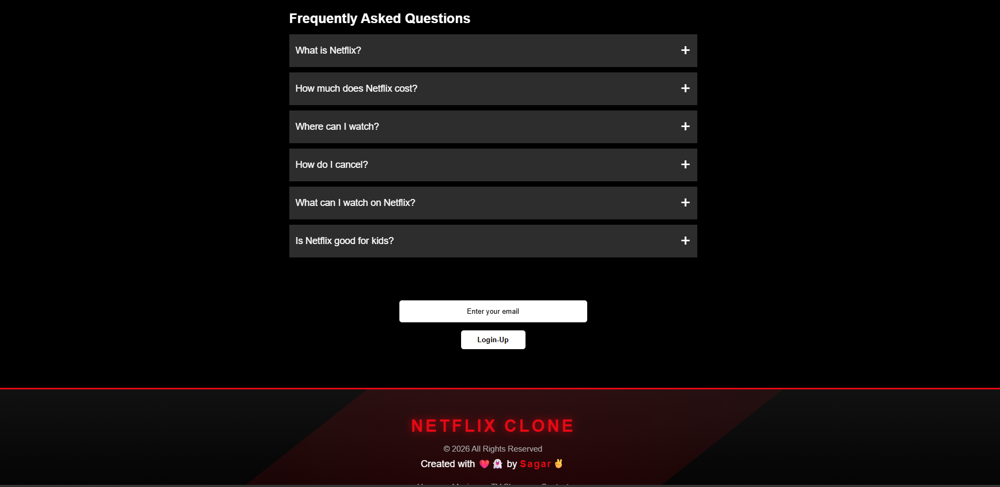

# 🎬 Netflix-Inspired Streaming Website

A responsive Netflix-inspired streaming website built using HTML, CSS, and JavaScript. This project provides a modern streaming-platform interface with trending content, movie categories, streaming service logos, search functionality, and interactive video previews.

## 📌 About the Project

The Netflix-Inspired Streaming Website is a frontend web development project created to practise HTML, CSS, and JavaScript. It brings together movie and TV content in a user-friendly interface inspired by popular streaming platforms.

The website includes promotional content, movie and TV categories, a streaming-platform slider, language selection, and interactive elements to improve the browsing experience.

**Project Name:** Netflix-Inspired Streaming Website  
**Project Type:** Frontend Web Development  
**Domain:** Entertainment and Streaming UI  
**Technologies:** HTML5, CSS3, JavaScript

## ✨ Features

- Netflix-inspired homepage and user interface.
- Trending movie and entertainment content.
- Movie, TV, and animation category filters.
- Search interface for discovering content.
- Streaming-platform logos and slider.
- Video modal and interactive video previews.
- Language selection for English, Hindi, and Marathi.
- Membership email input section.
- Sign-out interface.
- Responsive styling for different screen sizes.
- Movie posters, platform images, and website favicon.

Note: Features that require server-side authentication, subscriptions, or a streaming service API are not implied by the frontend interface alone.

## 🛠️ Technologies Used

| Technology | Purpose |
| --- | --- |
| HTML5 | Website structure |
| CSS3 | Styling, layout, and responsive design |
| JavaScript | Interactivity, filtering, and UI behaviour |
| Git | Version control |
| GitHub | Source code hosting |

## 📸 Project Screenshots

Add screenshots captured from the actual running website to a screenshots/ folder. Then use the following links:

### 🏠 Home Page

### 🔥 Trending Content

### 🎬 Video Preview

### ❓ Question and Answer Section

Click a screenshot to open the full-size image. Image paths must match the uploaded filenames.

## 📂 Project Structure

text
netflix-inspired-streaming-website/
├── assets/
├── index.html
├── style.css
├── script.js
├── favicon.ico
├── movie-poster-images
├── streaming-platform-images
├── video-files
└── README.md
 

The movie images, platform logos, and video files shown above describe the types of assets in the repository; individual filenames are listed separately in GitHub.

## 🚀 How to Run the Project

### Prerequisites
- A modern web browser.
- Visual Studio Code (recommended).
- Git (optional).

### Installation

1. Clone the repository:

 bash
   git clone https://github.com/Sagar-Lokhande-tech/netflix-inspired-streaming-website.git
  

2. Open the project folder:

   bash
   cd netflix-inspired-streaming-website
    

3. Open the folder in Visual Studio Code.
4. Open index.html in your browser, or use the Live Server extension.
5. Explore the website's categories, search interface, platform slider, language options, and video previews.

## 🎯 Learning Outcomes

- Creating a multi-section website using HTML.
- Styling layouts and responsive components with CSS.
- Using JavaScript for interactive user-interface behaviour.
- Organizing images, icons, and video assets.
- Working with event handling and DOM manipulation.
- Publishing and managing a project using Git and GitHub.

## 🔮 Future Enhancements

- Add a backend for user accounts and authentication.
- Integrate a movie database API for dynamic content.
- Implement a persistent watchlist and user preferences.
- Improve accessibility and responsive behaviour.
- Deploy the website for public access.

## 👨‍💻 Author

**Sagar Anil Lokhande**

Aspiring Java Full Stack Developer

- GitHub: https://github.com/Sagar-Lokhande-tech
- Project Repository: https://github.com/Sagar-Lokhande-tech/netflix-inspired-streaming-website

## ⚠️ Disclaimer

This project is created for educational and portfolio purposes. It is inspired by the design of streaming platforms and is not affiliated with or endorsed by Netflix. All trademarks belong to their respective owners.

---

If you find this project interesting, feel free to explore the repository and share feedback.
